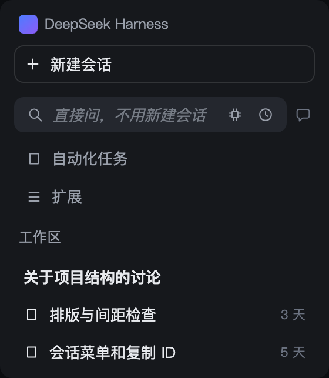
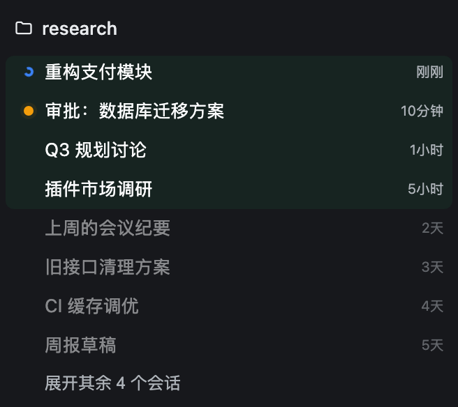
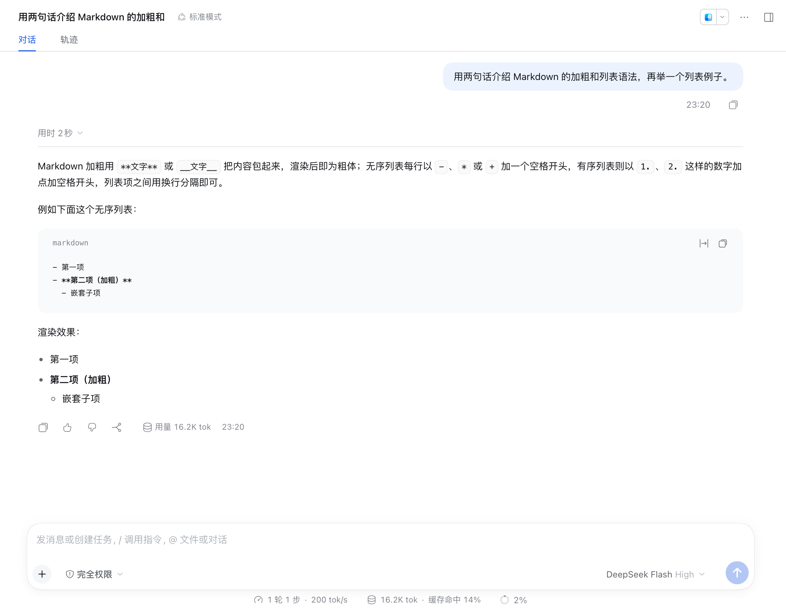
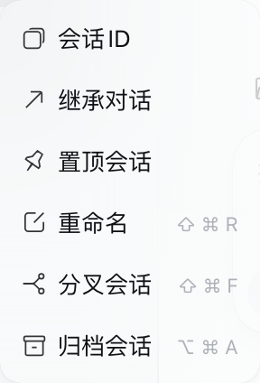
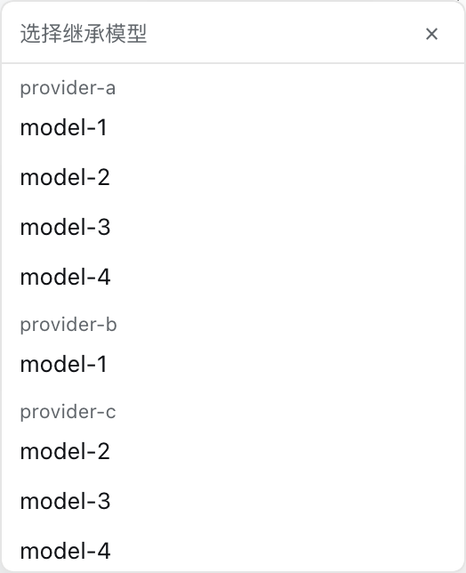
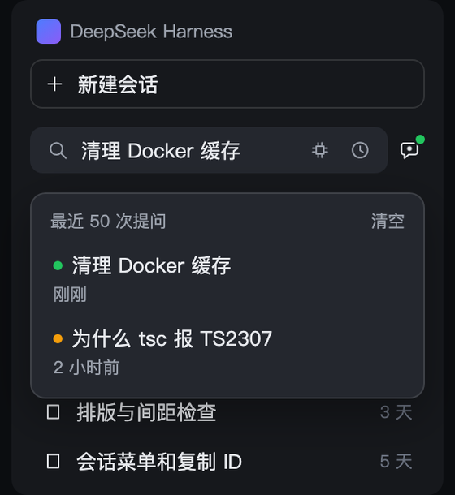
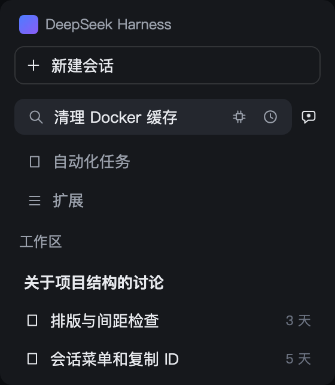
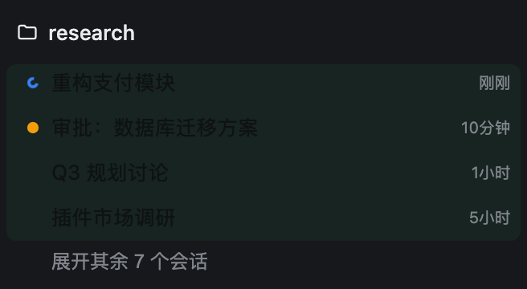
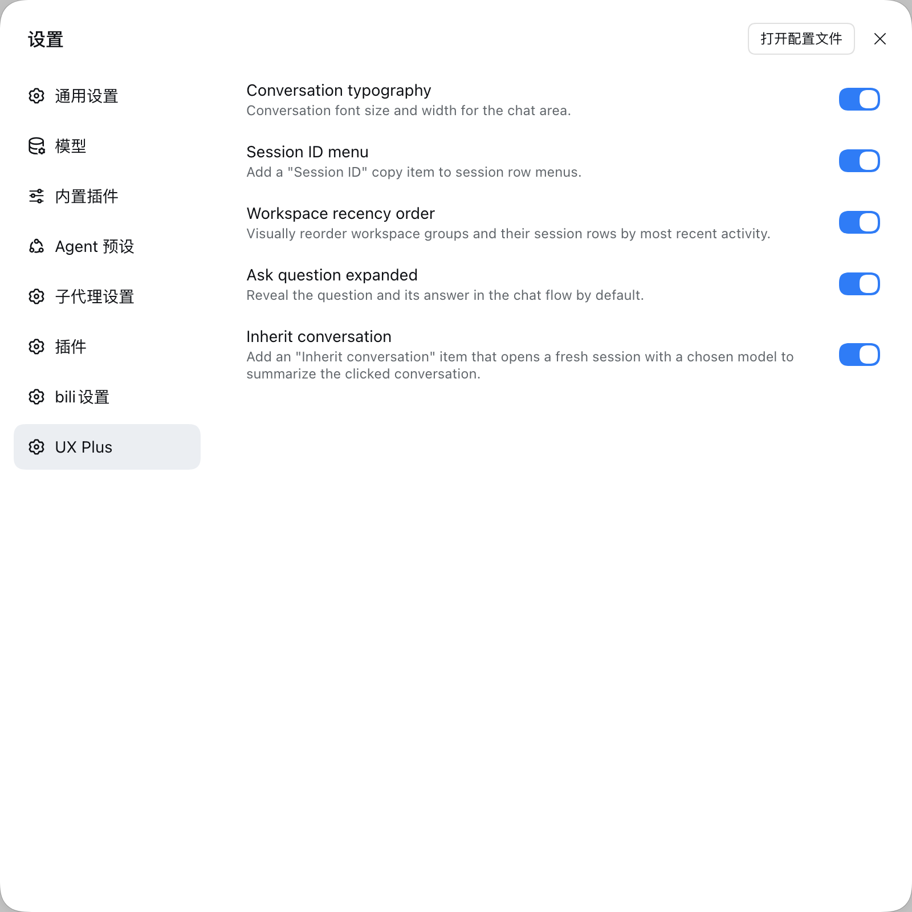

#  dsh-ux-plus

Small interface improvements for the DSH Web chat. Each feature has its own switch under **Settings → UX Plus** and applies instantly.

[](https://github.com/plyflai/dsh-ux-plus/actions/workflows/ci.yml)
[](LICENSE)
[](https://awesome-dsh-plugin.com)

**English** · [简体中文](./README.zh-CN.md)

**Targets the Web UI of [DeepSeek Harness 0.2.1-rc.1](https://github.com/deepseek-ai/deepseek-harness/releases/tag/dsh-v0.2.1-rc.1).**

## New in 0.5.0 — the "create a workspace first" step is gone

You just want to look something up, and the price used to be: create a workspace, then invent a name for it. That step is gone. A search box now lives under **Automated tasks** in the sidebar: type, press Enter, and you get exactly the session UI you already know — except this session files itself into a hidden workspace instead of your sidebar.

- **three clicks saved**: no new workspace, no name to invent, no directory to pick — just start asking or searching
- magnifier on the left, a tiny model picker on the right (host default model unless you pick one)
- the clock icon on the right is history: your last 50 searches, one click back to that session
- the hidden workspace is `.dsh-ux-plus/search` under your home directory, created on first use and never shown in the sidebar



[Details →](#quick-ask)

## New in 0.4.0 — the tab tells you what's happening

The whale favicon keeps its shape and carries three signals while you sit on another tab:

- whale **breathes** — something is computing
- **green whale** — a run finished and you haven't opened it
- **blinking orange dot** — something waits for your click

The signals are independent and compose freely; plain whale when nothing is up. [Details →](#attention-favicon)

## Features

Each row lists only what you can see and do in the interface.

| Feature | Interaction detail | Preview |
| --- | --- | --- |
| **Quick ask** | • Below 【New session】, always one row; yields when the sidebar collapses to the rail<br>• Type one line, press Enter: an ordinary Session starts — no workspace, no name to invent<br>• Model: the small icon on the right; leave it alone to follow the host default<br>• History: the clock icon, last 50 searches, one click back to that Session<br>• Bubble: one click returns to your newest search Session; a dot lights inside while it runs — green when an answer is unread, amber when a turn waits on you<br>• Search Sessions stay out of the sidebar; switch the feature off and they come back |  |
| **Tab attention marker** | • A Session is working: the whale on the tab breathes slowly<br>• Something finished unseen: the whale turns green, the same green as the list dot<br>• Something waits for you: an orange dot blinks in the corner<br>• Neither: the host's own icon comes back; subagents and blank Sessions never light it | — |
| **Recency order** | • Sessions running or touched today fold into a pale-green Active block, history below it<br>• State dots: orange (waiting for you), blue (running), green (finished unseen)<br>• Expand through the host's own 【show N more】, pinned right under the block<br>• Newest on top; a workspace with running or waiting members moves up too<br>• 【Ungrouped】 always sinks to the bottom, however new it is<br>• Idle for more than a day: the workspace folds away; hover a row to see how long ago<br>• Only the visible order changes; the host's grouping and sort settings stay put |  |
| **Conversation type size and width** | • Settings → General → Conversation<br>• Five type sizes, four reading widths<br>• Applies at once and only to conversation content |  |
| **Copy Session ID** | • One click in the Session row menu<br>• If the browser refuses, the menu says so in place; click again |  |
| **Inherit conversation** | • Same menu: pick 【Inherit conversation】, choose a model<br>• A new Session opens in the current workspace and carries on from the old one; the original is untouched<br>• On failure the picker stays open so you can retry |  |
| **Ask result expanded** | • When the question is answered, question and answer open themselves<br>• Collapse it yourself and it stays closed<br>• That card is the only pale-blue block in the conversation | — |

## Feature details

### Quick ask

A box sits permanently under **New session** in the sidebar and drops both "create a workspace first" and "start a new session" steps: ask or search right away — type, press Enter, and an ordinary session opens (same UI as any other session) while filing itself into a hidden workspace, out of your sidebar.


| Element | Behaviour |
| --- | --- |
| Input (magnifier on the left) | Enter searches straight away (the field is single-line); an Enter that ends an IME composition never submits by accident |
| Model picker | A small chip icon on the right: click it for the model list (the current pick is ticked). Leave it alone to use the host default; a non-default pick puts a dot on the chip and is remembered locally |
| Session bubble (far right) | One click returns to the newest search session, finished or not. While a search is running a dot lights inside the bubble and breathes — never a number. A small corner dot carries the state: **green** = the answer arrived and is unread, **amber** = a turn is waiting for your reply. Dim and inert while there is no search session yet |
| Clock icon (right) | Opens history: the last 50 searches, one click reopens that session, one button clears the list. Each row carries the same dot — green for an unread answer, amber for a pending question |
| Sidebar | Search sessions **never show up** — they all live in the hidden workspace |



- The hidden workspace is `.dsh-ux-plus/search` in your home directory, created on first use. It is not in the workspace list and has no group in the session tree, yet the history popup still takes you back to any old search session.
- The box only appears while the sidebar is expanded; in the collapsed rail it steps aside.
- Turning the switch off removes the hidden-workspace rule too — those sessions simply reappear in the sidebar, nothing is lost.

Type a question in that box, the icons on the right stay put, Enter opens an ordinary session:



While a search is running, a dot lights up inside the right-hand bubble; a click returns to the newest search session — finished or not.

### Attention favicon

The tab icon stays the host's whale. This feature only tints it, breathes it, or adds one dot — and only while there is something to say.

| Tab signal | Meaning |
| --- | --- |
| whale **breathes** (slow fade) | any counted session is computing |
| **green whale** | a finished session has not been opened — exactly when the workspace list shows its green dot |
| **blinking orange dot** | something is waiting for your click (approval, question, plan review) |
| plain whale | nothing is up; the host's icon is restored untouched |

The breath has a 35% opacity floor and the blink is asymmetric, so a background tab throttled to ~1 tick/s still shows the alert on whatever frame it freezes on; returning to the tab restarts the cycle from the visible frame. Subagent and blank sessions never light the tab. Both host themes (light / dark) are kept; if the host's whale cannot be re-tinted, the feature quietly does nothing. Switching off leaves no residue.

### Workspace recency order

Most recent first — the project you were just in stays at the top. Visual order only; the host's sort settings and data are untouched.

**Active block.** Running, or touched within 24 hours: one continuous green-backed band of compact 26px rows, each led by its status dot — orange breathing (awaiting you), blue spinner (running), solid green (finished, unread). A workspace header carries up to three pure-colour dots while that attention is hidden from view; the counts stay in its tooltip.

**History stays hidden.** No fold bar of its own — the host's own "Expand N more sessions" button is the one control, pinned directly below the Active block. One press opens the section: every row appears, the button returns to the list's native bottom, and the section reads exactly like the host's own expanded list. 收起 folds it back.

<table><tr>
<td width="50%"></td>
<td width="50%"></td>
</tr></table>

**The ungrouped bucket sinks.** Sessions that belong to no workspace share the 【Ungrouped】 section, which always sits at the very bottom — a fresh, even running, stray session never pushes a workspace down.

**Idle tidying.** A workspace with no activity for over 24 hours collapses once when the page opens, and shows its age on hover (now / Nm / Nh / Nd). Workspaces holding a running or awaiting session are never auto-collapsed.

Reordering pauses while your pointer is in the list or a menu is open — and pierces on your own actions: view-option changes and the expand button restyle on the click's own frame. Rows glide (FLIP, off under `prefers-reduced-motion`), zones re-check on a timer so rows fall asleep across the 24-hour line, and a section that briefly sees rows it cannot explain keeps its last consistent look instead of flickering.

### Conversation typography

The chat area defaults to 14px. Bump the font size and narrow the reading width under **Settings → General → Chat area** — conversation content only, never the whole interface.

### Session menu: Session ID & Inherit conversation

Each session row's overflow menu gains two items, before the native Pin / Rename entries:

- **Session ID** — copies the ID to the clipboard, for `--session` resumes and log digging.
- **Inherit conversation** — a model picker opens at the click position. Pick a model and the plugin creates a new session in the same workspace, switches it to that model, posts an inheritance prompt ("summarize and carry on, weighting the latest turns"), and jumps there. The original session is untouched. Good for finishing a long session on a pricier model, or continuing elsewhere when a provider rate-limits.

### Ask question expanded

When an `ask_user_question` card finishes, the question and its answer stay expanded — reviewing a decision costs one less click.

### Settings

**Settings → UX Plus**: six independent switches, on by default, applied instantly.



## Install

Requires Node.js ≥ 22, pnpm on PATH, and a DSH Web profile.

```bash
dsh plugin --profile <name> add github:plyflai/dsh-ux-plus
```

Restart the profile afterwards. Toggle each feature under **Settings → UX Plus** (on by default, instant). Conversation font size and width live under **Settings → General → Chat area**.

## Compatibility

- Web UI (browser) only — not the terminal TUI.
- Every feature mounts on public host extension points; no host source is modified, and each feature can be switched off individually.
- Host upgrades may shift internal DOM and slot contracts; file an issue if something breaks.

## Development

```bash
npm install
npm test        # node --test, incl. static assertions on the built artifact and injected deps
npm run build   # tsdown emits lib/client.js (classic script, committed to the repo)
```

- Each feature is a private `features/<name>/` module (host + client halves) registered in the feature lists of `src/index.js` and `src/switches.js` — not a standalone plugin.
- The client bundles into a single classic script injected into `window.__ModuleLoader__`; external dependencies are strictly limited to the module seeds the host provides, enforced by the build script.
- Every push to main appends one entry to the update log below and syncs [CHANGELOG.md](CHANGELOG.md).

## Update log

The five most recent entries; full history in [CHANGELOG.md](CHANGELOG.md).

- **v0.5.21 · 2026-10-21** — The box moves to just under 【New session】 (it used to sit above 【Automation tasks】, on top of the workspace list); the hint is now "Just ask, no new session" and the feature is called "Quick ask".
- **v0.5.20 · 2026-10-21** — the quick-search docs now show the state dots: a green corner dot on the bubble for an unread answer, amber for a pending reply, and on every history row.
- **v0.5.19 · 2026-10-21** — The session bubble at the right end of the search box carries a state dot: green when an answer finished and is still unread, amber when a turn is waiting for your reply. The history popup shows the same dots beside each search.
- **v0.5.18 · 2026-10-21** — No more empty block left by the hidden workspace: only its title row and session rows used to be hidden, so the sidebar kept an untitled strip holding nothing but 【show N more】. The whole section is taken away now.
- **v0.5.17 · 2026-10-21** — 【Ungrouped】 is pinned to the bottom of the sidebar workspace list: a stray session that was just used, or is even running, can no longer push a workspace down.
- **v0.5.16 · 2026-10-21** — The previews are capped at 170px, so the Interaction detail column roughly doubles (270px → 575px) instead of the screenshot taking half the table. Docs only.

## License

[MIT](LICENSE) © 2026 plyflai
