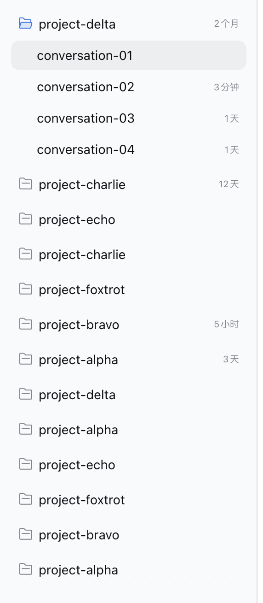

# dsh-ux-plus

UX enhancements and quality-of-life plugins that make DeepSeek Harness easier to handle.

[](https://github.com/plyflai/dsh-ux-plus/actions/workflows/ci.yml)
[](LICENSE)

**English** · [简体中文](./README.zh-CN.md)

**Currently targeting the Web UI of [DeepSeek Harness 0.2.0-rc.1](https://github.com/deepseek-ai/deepseek-harness/releases/tag/dsh-v0.2.0-rc.1).**

## Features

| Feature | Why you'll like it | Preview |
| --- | --- | --- |
| Conversation typography | **[One-click comfort]** Pick a comfortable font size and reading width for the chat area. Long answers read easier, wide screens get used properly — without zooming the whole interface. |  |
| Session ID menu | **[Grab it in one click]** Copy a session's ID straight from its row menu — for `--session` resumes, locating records, or debugging, with no manual text selection. |  |
| Workspace recency order | **[Jump back + auto-tidy]** Sessions that need you — awaiting reply, running, unread — pin to the top and bubble up as workspace badges when hidden; dormant ones shrink and fold away; workspaces idle for over a day collapse on their own and show their age. |  |
| Ask question expanded | **[Fewer clicks on review]** When a question finishes, the question and its answer stay expanded — checking a decision costs one less click. | — |
| Inherit conversation | **[Switch models, keep going]** Pick a model in the session menu: a brand-new session in the current workspace reads the old conversation's progress and carries on. |  |

## Feature details

### Conversation typography

The chat area defaults to 14px. When answers get dense, bump the font size and narrow the reading width under **Settings → General → Chat area** — it only affects conversation content, never the whole interface.

### Session menu: Session ID & Inherit conversation

Each session row's overflow menu gains two items (placed before the native Pin / Rename entries):

- **Session ID**: copies the session's ID to the clipboard — for `--session` resumes, log digging and similar workflows.
- **Inherit conversation**: see below.

### Inherit conversation

Clicking "Inherit conversation" opens a lightweight model picker at the click position, listing every routable model (grouped by provider):

After you pick a model, the plugin:

1. creates a brand-new session **in the original session's workspace**;
2. switches the new session to the model you just picked;
3. posts an inheritance prompt — the inherited session's ID plus "Summarize and inherit this conversation's progress, giving the most attention to the latest turns";
4. jumps to the new session, where the model starts reading the old conversation, summarizing progress and carrying on.

Great for: a session that ran too long and deserves a pricier model to finish; a rate-limited provider where you want to continue elsewhere; or simply transplanting progress into another model's context. The original session is untouched, and the Session ID copy stays as-is.

### Workspace recency order (liveness, idle collapse, folding)

Workspace groups and their session rows sort by most recent activity, so multiple parallel projects never bury the one you were just in; only the visual order changes — the host's sort settings and data stay intact.

On top of recency, rows are ranked by **liveness** — the same signals the host's row dots show: sessions awaiting your reply and running sessions pin to the top of their workspace, unread finished sessions come next, and the session you are in stays at the top of the "recent" band. A workspace holding a running or blocked session also floats up in the group list. An unread session older than 7 days dims (color only, never moves): the dot is a fact, not a to-do, and never auto-clears.

**Dormant sessions shrink**: rows untouched for over 7 days render compact, and from the fourth on they fold into a single "fold earlier · N · latest time" row — one click reveals them all for the rest of the page load. When attention rows are hidden by collapse, the 5-row cap or folding, the workspace row shows a count badge (e.g. "2 awaiting · 1 unread") until they are visible again; workspaces with running or awaiting sessions are never auto-collapsed.

Reordering never fights you: it pauses while the pointer is inside the tree or a menu is open (deferred, never dropped), glides rows with a short FLIP transition (off under `prefers-reduced-motion`), and uses a 5-minute hysteresis at the group level so dormant workspaces don't bounce back just because you read one of their rows.

The same feature also handles **idle tidying**: a workspace with no real activity for over **24 hours** (blank and subagent sessions don't count — same signal as the ordering) collapses automatically once when the page opens, and every workspace row shows its age on the right — now / Nm / Nh / Nd / Nmo / Ny — styled exactly like the host's session-row timestamps and hidden on hover.

Auto-collapse fires at most once per workspace per page load: re-expand it manually and it stays expanded. Workspaces without sessions (or with only blank / subagent sessions) have no activity signal — never labeled, never collapsed. Labels follow the DSH language and light/dark theme.

### Settings

Open **Settings → UX Plus**: all five features have independent switches, on by default, applied instantly.


## Install

Requires Node.js ≥ 22, pnpm on PATH, and a DSH Web profile.

```bash
dsh plugin --profile <name> add github:plyflai/dsh-ux-plus
```

Restart the profile afterwards. Open **Settings → UX Plus** to toggle each feature; features are on by default and each switch applies instantly.

Conversation font size and width live under **Settings → General → Chat area**.

## Compatibility

- Web UI (browser) only — not the terminal TUI.
- Every feature mounts on public host extension points (sidebar slots, settings forms, DOM tweaks); no host source is modified, and each feature can be switched off individually.
- Host upgrades may shift internal DOM and slot contracts; file an issue if something breaks and it usually gets fixed in the next version.

## Development

```bash
npm install
npm test        # node --test, incl. static assertions on the built artifact and injected deps
npm run build   # tsdown emits lib/client.js (classic script, committed to the repo)
```

- Each feature is a private `features/<name>/` module (host + client halves) registered in the feature lists of `src/index.js` and `src/switches.js` — not a standalone plugin.
- The client bundles into a single classic script injected into `window.__ModuleLoader__`; external dependencies are strictly limited to the module seeds the host provides, enforced by the build script.
- Every push to main appends one entry to the update log below and syncs [CHANGELOG.md](CHANGELOG.md).

## Update log

The three most recent entries; full history in [CHANGELOG.md](CHANGELOG.md).

- **v0.2.0 · 2026-10-15** — Recency order becomes liveness order: awaiting-reply / running / unread sessions pin to the top and bubble up as workspace count badges when hidden; dormant sessions render compact and fold behind a "fold earlier" row; reordering freezes under the pointer or an open menu; unread dots never auto-clear.
- **v0.1.7 · 2026-10-14** — README restructured: English-first with a [Chinese counterpart](./README.zh-CN.md), screenshots moved into the feature table, update log trimmed to the three latest entries.
- **v0.1.6 · 2026-10-14** — Idle workspace collapse and age labels are no longer a standalone feature: folded into Workspace recency order (same switch, same activity signal); settings back to five rows.

## License

[MIT](LICENSE) © 2026 plyflai
